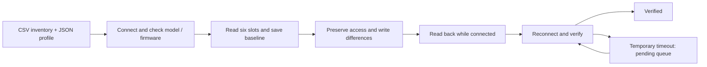

# Minew E8 Batch Tool

**Configure a group of Bluetooth tags from a Windows laptop—and keep a recoverable record of every change.**

This command-line tool applies a JSON configuration to an explicitly selected CSV inventory of Minew tags. It processes one tag at a time, saves the original settings, reads changes back, and verifies the result after reconnecting.

**Windows · Python 3.12 · Bluetooth LE · Beacon Plus-BL / firmware 2.3.17**

[Install](#installation) · [First batch](#run-your-first-batch) · [Profiles](docs/PROFILES.md) · [Recovery](docs/RECOVERY.md) · [Batch workflow](docs/BATCH_WORKFLOW.md) · [Validation](docs/VALIDATION.md)

> This is an independent tool, not an official Minew application. Configuration is deliberately restricted to the model and firmware tested. Start with a small group before a large deployment.

## What it does

| Capability | Behavior |
|---|---|
| Discover nearby tags | Produces an inventory with every device disabled until you select it. |
| Change broadcast settings | Sets advertising intervals and transmit power on supported active slots. |
| Enable accelerometer broadcasts | Changes an empty or ACC slot to an ACC advertising slot. |
| Disable an ACC slot | Preserves an active Bluetooth configuration path. |
| Preview a batch | Shows per-tag differences before applying a profile. |
| Verify changes | Reads all six slots and connection modes, including after reconnecting. |
| Resume interrupted work | Uses a durable state file and reads the current settings before deciding what remains. |
| Restore previous settings | Restores each tag's first saved baseline, rather than guessing a shared default. |
| Handle temporary connection failures | Optional delayed retry passes, pending verification, and a pause after repeated connection failures. |

The tool connects **directly over Bluetooth**. An MQTT broker, receiver gateway, cloud account or Minew phone connection is not required to run it.

It does **not** calculate tag locations, manage gateways, flash firmware, change passwords, or create an iBeacon identity in an empty slot. Existing iBeacon identities are retained.

## Supported devices

| Item | Supported / tested |
|---|---|
| Tag family | Minew E8 units identifying as `Beacon Plus-BL` |
| Firmware | **`2.3.17`**—checked before configuration |
| Software reported by tested tags | `nRF52-SDK13.0`—descriptive, not the device guard |
| Computer | Windows with a BLE-capable adapter and functioning drivers |
| Python | **3.12**, including the Windows `py` launcher |
| Dependencies | `bleak==3.0.2`, `cryptography==50.0.1` |

Other models and firmware are rejected. macOS and Linux are not supported by this version: the scanner uses Windows-specific advertisement data and the state locks use Windows APIs.

## Installation

### 1. Download the source

On this repository's GitHub page, choose **Code → Download ZIP**, extract it to a writable folder, and open PowerShell in that extracted folder. Alternatively, clone the repository with Git:

```powershell
git clone https://github.com/timyoth/minew-e8-batch-tool.git
cd minew-e8-batch-tool
```

Use the folder containing `setup.cmd` and `minew.cmd`; do not run commands inside the ZIP viewer.

### 2. Install Python and the dependencies

Install Python **3.12** with its Windows launcher. Confirm it is available, then run setup:

```powershell
py -3.12 --version
.\setup.cmd
.\minew.cmd --help
```

`setup.cmd` creates `.venv` and installs the pinned dependencies from `requirements.txt`. The initial install needs internet access. `minew.cmd` uses this environment automatically; you do not need to activate it manually.

### 3. Supply the local protocol bootstrap file

Configuration commands require an authorized **16-byte** file named `sdk_bootstrap_key.bin`, located beside `configure_tag.py`. It is a protocol bootstrap constant, **not** your tag's connection password.

The public source copy intentionally omits this local file, and `setup.cmd` does not generate it. Ask the tool maintainer for the authorized bootstrap file through a private handoff before using `plan`, `apply`, `rollback`, or `recover`. Do not substitute a text password or an arbitrary key. Discovery and the offline tests can run without it. **Downloading this repository alone is not enough to configure tags.** No self-service download or extraction procedure for this file is provided here.

Check that the file has the expected size without printing its contents:

```powershell
(Get-Item .\sdk_bootstrap_key.bin).Length
# Expected: 16
```

Run the local readiness check:

```powershell
.\minew.cmd doctor
```

It prints Python/dependency versions and checks the bootstrap file length without displaying its contents or contacting tags. Missing or malformed files return a nonzero exit code. A successful check does not validate the key contents, adapter, password or radio connection.

### 4. Prepare the tags

Enable Windows Bluetooth, put the intended tags nearby in a single layer, and disconnect/close the Minew phone app. Keep the laptop awake and the tags powered throughout the run. Use one Bluetooth job at a time.

## Run your first batch

The example below enables **ACC in Slot 2 at 1,000 ms and −4 dBm**. It retains the other slots unless a connection-path adjustment is necessary to preserve access.

### 1. Scan

```powershell
.\minew.cmd scan --seconds 30 --output tags.csv
```

The scan lists nearby BLE devices with `enabled=no`. It is a candidate list, not proof that each device is yours or that every tag was found. An existing output file is not overwritten.

### 2. Select your tags

Edit `tags.csv` and change `enabled` to `yes` only for your intended MAC addresses. Keep the header; extra columns from the scan can remain.

```csv
mac,enabled
C3:00:00:00:00:01,yes
C3:00:00:00:00:02,no
```

These are **illustrative addresses**. Use the real addresses from your inventory. `inventory.example.csv` starts with all example tags disabled.

### 3. Preview the changes

```powershell
.\minew.cmd plan --inventory tags.csv --profile profile_acc_1s.json --default-password --output acc_plan.json
```

An existing plan file is not overwritten; use a new name for each preview. Review `acc_plan.json`, especially each tag's `changes` and any errors. `plan` reads the settings without applying the profile; it selects slots while reading them.

`--default-password` uses the factory password `minew123`. **Omit that flag** to enter a different password through a hidden prompt. Passwords must be eight ASCII letters/digits. Use separate runs for tags with different passwords.

### 4. Apply with delayed retries

```powershell
.\minew.cmd apply --inventory tags.csv --profile profile_acc_1s.json --default-password --state acc_state.json --auto-retry
```

The tool saves a baseline before writing. It reads the target back while connected, disconnects, and checks again through a fresh connection. A temporary reconnect timeout becomes `pending_verify`, not success and not an immediate rollback.

With `--auto-retry`, it continues with other tags and later revisits eligible temporary failures. Default settings allow two additional passes, wait 30 and 60 seconds before those passes, and pause after three consecutive transient connection failures.

Without `--auto-retry`, a final failure or pending verification stops the run. For all options:

```powershell
.\minew.cmd apply --help
```

### 5. Check completion and keep the state

| File | Purpose |
|---|---|
| `acc_state.json` | Original snapshots, targets, results and recovery checkpoints. **Keep this file.** |
| `acc_state.csv` | Compact per-tag status summary. |
| `acc_state.progress.json` | Inventory-wide progress in automatic mode, including tags not attempted. |
| `acc_plan.json` | Your pre-apply preview. |

`verified` means a full snapshot matched the target. Changed tags are checked after reconnecting; tags that already match are confirmed in their initial session. A resumed run skips previously verified tags unless `--recheck` is supplied. **`pending_verify`, `failed`, and `needs_recovery` are not completed tags.** An automatic run exits with code `0` only when every selected tag is verified; unresolved entries produce a nonzero exit code.

To resume, repeat the **same apply command with the same inventory, profile and state file**. Previously verified tags are skipped; unfinished tags are read and reconciled before another write. Keep unresolved tags in the inventory.

## Return tags to their previous settings

```powershell
.\minew.cmd rollback --inventory tags.csv --profile profile_acc_1s.json --default-password --state acc_state.json
```

Rollback uses each tag's **first original snapshot** in that state file, including all six slots and connection modes. It can overwrite changes made after that baseline was saved. Use a new state file for a new profile or a separate experiment. State filenames must end in `.json`; their derived CSV/progress files must not collide with your inventory or profile.

Rollback stops when a tag cannot be restored or lacks a saved baseline. See [Recovery and troubleshooting](docs/RECOVERY.md) for interrupted runs, partial batches, battery-startup recovery and status meanings.

For a read-only audit, run `plan` again. `apply --recheck` can **write corrections** and is not a read-only audit. Configuration readback also does not prove every radio packet reached your gateways; inspect live receiver traffic when field-test reception matters.

## Included profiles

| Profile | Intended result |
|---|---|
| `profile_acc_1s.json` | Slot 2 ACC at 1,000 ms / −4 dBm. Recommended starting example. |
| `profile.json` | Existing Slot 1 iBeacon at 900 ms / 0 dBm; Slot 2 ACC at 100 ms / −4 dBm. CLI default if `--profile` is omitted. |
| `profile_high_power.json` | Same intervals as `profile.json`, both main slots at +4 dBm. |
| `profile_acc_off.json` | Disable Slot 2 while retaining a working configuration path. |
| `profile_slot6_test.json` | Add temporary Slot 6 ACC at 1,000 ms / 0 dBm; restore with rollback. |
| `profile_storage.json` | Experimental reduced-broadcast profile; see the limitations below. |

Profiles use **app slot numbers 1–6**. The example explicitly passes `--profile` so the faster 100 ms default ACC profile is not selected accidentally. See [Profile reference](docs/PROFILES.md) to write your own.

## Large batches and storage mode

Start with a small pilot, then consider labelled trays of 25–50 tags. That tray size is a proposed workflow, not a proven radio-capacity limit. Retain one inventory and state file per tray, and resolve the exception list before treating a tray as complete. See [Batch workflow](docs/BATCH_WORKFLOW.md).

The experimental storage profile disables ACC broadcasts and slows iBeacon and the existing Slot 5 telemetry to five seconds. It is **not full sleep**, has **no measured battery-life benefit**, and required connection retries during the trial. The seven tags used in that trial were subsequently restored. It is not the recommended default for field testing or a large unattended rollout.

## Validation and limitations

- **50 tags:** ACC configuration was eventually verified on all 50; a later live scan observed both iBeacon and ACC from all 50. Retries and some physical recovery were needed.
- **10 tags:** power changes and temporary ACC slot addition/removal passed reconnect checks.
- **7 tags:** a partial storage trial was restored to the exact saved normal configurations and verified.
- **48 offline regression tests:** cover validation, write ordering, connection preservation, retries, pending verification, interruption handling, rollback and current Windows advertisement handling.

These results are not a guarantee of zero failures or proof of a 550/600-tag deployment. The detailed [validation record](docs/VALIDATION.md) separates hardware observations from mocked tests. Full raw field logs and device inventories are not published here.

Setup installs dependencies but does not contact tags. Run the tests without a Bluetooth device or bootstrap key:

```powershell
.\.venv\Scripts\python.exe -m unittest discover -s . -p "test_*.py" -v
```

## How it works



Confirmed mismatches and incomplete writes attempt restoration of the pre-attempt snapshot. Explicit rollback restores the first baseline in the state file. A missing connection is never proof that a tag accepted its settings. The device guard, explicit inventory selection, durable checkpoints and reconnect checks are designed to make failures visible and recoverable; they cannot guarantee recovery from every battery, firmware or radio failure.

## Documentation

- [Profile format and supported settings](docs/PROFILES.md)
- [Status meanings, troubleshooting and recovery](docs/RECOVERY.md)
- [Tray workflow and rollout checklist](docs/BATCH_WORKFLOW.md)
- [Validation history and technical notes](docs/VALIDATION.md)
- [Developer guide](docs/DEVELOPMENT.md)

When reporting a problem, include the model, firmware, command, status/error and whether the phone app was closed. Remove credentials, full inventories and other private information from public reports.
